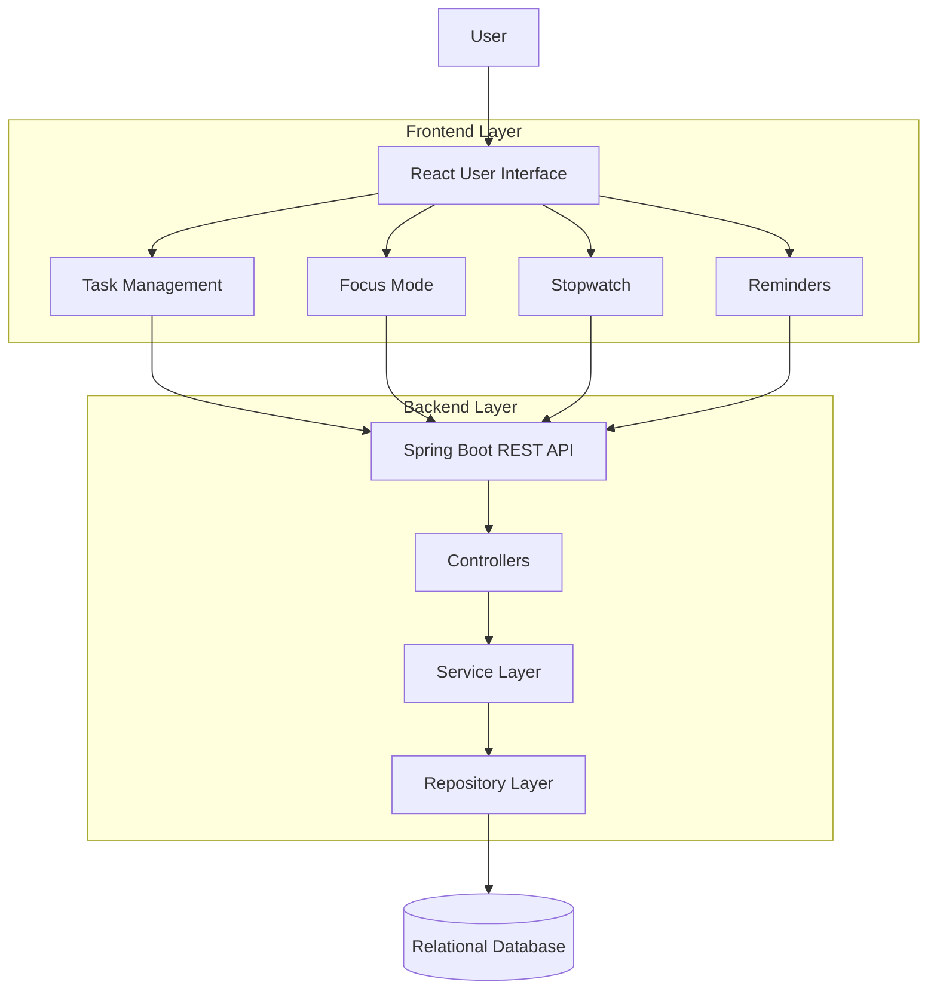

# Productivity Assistant

A productivity management application designed to help users organize their work, manage daily tasks, maintain focus, and track time effectively.

Productivity Assistant brings task management, focus sessions, stopwatch functionality, and reminders into a unified workspace, helping users structure their day and build consistent productivity habits.

## Core Features

### 1. Task Management
- Create and manage tasks.
- Organize daily activities and pending work.
- Track task completion and progress.
- Maintain a structured view of personal productivity.

### 2. Focus Mode
- Dedicated focus environment for uninterrupted work.
- Start and manage focused work sessions.
- Encourage structured working habits.
- Minimize distractions while completing important tasks.

### 3. Stopwatch
- Start, pause, resume, and reset the stopwatch.
- Track elapsed time during work sessions.
- Measure time spent on individual activities.
- Support time awareness and productivity tracking.

### 4. Reminders
- Create reminders for important tasks and activities.
- Set scheduled notifications.
- Stay informed about upcoming responsibilities.
- Reduce the chances of missing important tasks.

## Application Modules

| Module | Purpose |
|---|---|
| Task Management | Organize and manage daily activities |
| Focus Mode | Support uninterrupted work sessions |
| Stopwatch | Measure elapsed working time |
| Reminders | Schedule notifications for important activities |

## System Architecture

The application follows a frontend-backend architecture, separating the user interface from application logic and data persistence.



## Technology Stack

The following technologies should be updated to match the actual repository configuration.

| Layer | Technology |
|---|---|
| Frontend | React |
| Styling | Tailwind CSS |
| Backend | Java, Spring Boot |
| Persistence | Spring Data JPA, Hibernate |
| Database | MySQL / PostgreSQL |
| API Communication | REST APIs |

## Project Structure

```text
productivity-assistant/
│
├── frontend/
│   ├── src/
│   │   ├── components/
│   │   ├── pages/
│   │   ├── services/
│   │   └── assets/
│   └── package.json
│
├── backend/
│   ├── src/
│   │   └── main/
│   │       ├── java/
│   │       └── resources/
│   └── pom.xml
│
├── docs/
│   └── architecture.md
│
└── README.md
```

## Getting Started

### Prerequisites

- Java Development Kit
- Maven
- Node.js and npm
- Configured relational database

### Backend Setup

```bash
cd backend
mvn clean install
mvn spring-boot:run
```

### Frontend Setup

```bash
cd frontend
npm install
npm run dev
```

Configure the backend database connection and frontend API endpoint before running the application.

## Development Goals

The application aims to bring essential productivity utilities into a single platform rather than requiring users to switch between multiple independent applications.

Future enhancements may include:

- Productivity analytics and activity reports.
- Task prioritization and categorization.
- Focus session history.
- Daily and weekly productivity summaries.
- Integration between tasks, focus sessions, and reminders.

## Project Objective

To build a unified productivity workspace that helps individuals plan their work, stay focused, measure their time, and manage responsibilities efficiently.

---

**Productivity Assistant**  
Personal productivity through structured task management, focused execution, and effective time management.
